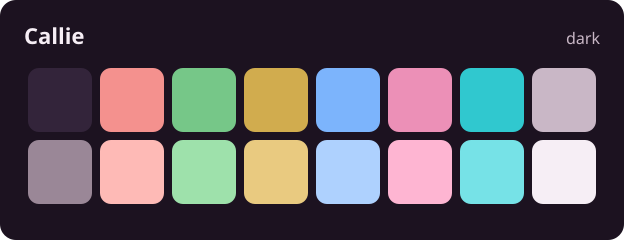
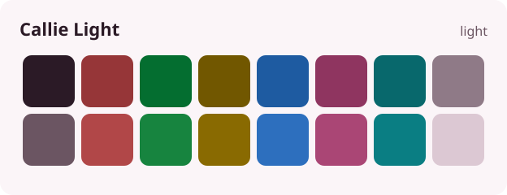

# Callie themes

The colors of [Callie](https://callieapp.org) and the other [Greylock Labs](https://greylocklabs.org)
apps, for your terminal, editor and projects: a dark **Callie** and a light **Callie Light**.

## Install

Each port has a file per variant under `ports/`.

- **kitty:** copy `ports/kitty/callie.conf` and `callie-light.conf` to `~/.config/kitty/`, and add
  `include callie.conf` to `kitty.conf`. To follow the desktop's light or dark setting, copy them
  as `dark-theme.auto.conf` and `light-theme.auto.conf` instead.
- **Konsole:** copy `ports/konsole/*.colorscheme` to `~/.local/share/konsole/`, then pick Callie in
  the profile's Appearance settings.
- **Ghostty:** copy `ports/ghostty/*` to `~/.config/ghostty/themes/`, and set
  `theme = light:Callie Light,dark:Callie`.
- **Alacritty:** add `general.import = ["/path/to/ports/alacritty/callie.toml"]` to
  `alacritty.toml`.
- **foot:** add `include=/path/to/ports/foot/callie.ini` to `foot.ini`.
- **WezTerm:** copy `ports/wezterm/*.toml` to `~/.config/wezterm/colors/`, and set
  `config.color_scheme = "Callie"`.

### Editors and apps

- **Neovim:** install this repository as a plugin, for example with lazy.nvim:
  `{ "greylocklabs/themes", name = "callie", priority = 1000, config = function() vim.cmd.colorscheme("callie") end }`.
  `callie` follows `background`, so `:set background=light` switches to Callie Light; `callie-light`
  sets it for you. It covers Treesitter, LSP and diagnostics, gitsigns, Telescope, bufferline,
  which-key, indent-blankline, neo-tree, nvim-tree, blink.cmp and nvim-cmp.
- **opencode:** copy `ports/opencode/callie.json` to `~/.config/opencode/themes/`, and set
  `"theme": "callie"` in `tui.json`. It follows the terminal's light or dark mode.
- **tuicr:** copy `ports/tuicr/*.toml` to `~/.config/tuicr/themes/`, and set `theme = "callie"`, or
  `theme_dark = "callie"` and `theme_light = "callie-light"` to follow the system.
- **herdr:** replace the `[theme]` section of `~/.config/herdr/config.toml` with
  `ports/herdr/callie.toml`, which keeps herdr's terminal theme and gives it Callie's pink accent
  and rows.
- **Claude Code:** copy `ports/claude-code/*.json` to `~/.claude/themes/`, then pick Callie in
  `/theme`. Claude's code and dialog borders use the warm yellow rather than the default blue.
- **lazygit:** merge `ports/lazygit/callie.yml` into `~/.config/lazygit/config.yml`, for a soft
  selected row and a pink border in place of the terminal's blue.
- **Slack:** paste the line in `ports/slack/callie.txt` into a message to yourself, then click the
  theme button Slack shows, or paste it under Preferences, Themes.
- **Discord:** with Vencord or BetterDiscord, both client mods Discord does not support, add
  `ports/discord/callie.theme.css` to their themes folder. It is a flavor of
  [refact0r's midnight](https://github.com/refact0r/midnight-discord), which it loads.
- **gh-dash:** merge `ports/gh-dash/callie.yml` into `~/.config/gh-dash/config.yml`. gh-dash
  needs every color set, so keep the whole `theme` section. Its companion gh-enhance only takes
  [bubbletint](https://lrstanley.github.io/bubbletint/) themes; `ENHANCE_THEME=rose_pine` is the
  closest.

### For your own projects

- `ports/css/callie.css` sets the colors as `--callie-*` CSS variables: light by default, dark when
  the system prefers it, and either one with `data-theme="light"` or `"dark"` on the root element.
- `ports/json/callie.json` holds every color, ANSI color and role for both variants, for build
  scripts and tools that read the palette themselves.

## How it works

`palettes/` holds the theme files, the same ones Callie reads, plus a `[terminal]` section with
the 16 ANSI colors. Each hue sits at one OKLCH lightness and chroma per variant, so no color shouts
over the others, with red starting from Callie's danger color and magenta from its pink accent.
`callie-light.toml` takes whatever it leaves out from `callie.toml`.

`scripts/generate.py` writes every port and preview from the palettes. Edit a palette, run it,
and commit both; CI fails when a port is out of date.

Commit messages follow the shared conventional style, with a scope always required. Run
`npm install` and `git config core.hooksPath .githooks` to check them locally.
